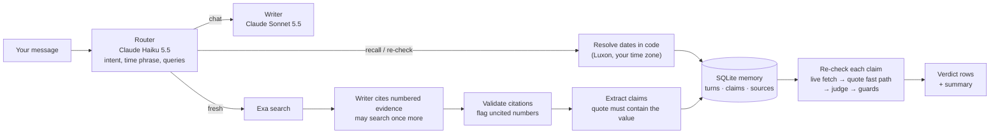

# minimi

**A chat agent with one tool, web search, that remembers what you asked and when, and can re-check what it told you.**

Ask about anything that changes (a price, a plan, a release) and minimi searches the web, answers with numbered citations, and saves each fact as a dated claim with the exact quote it came from. Days later, ask "Last Tuesday I asked you about Postgres hosting. Has any pricing changed since then?" and it finds that conversation on your calendar, fetches each source again live, and tells you, claim by claim, what still holds, what changed, and what it could not verify.

## Try it

Needs Node 22.13 or later, an Anthropic key and an Exa key.

```bash
cp .env.example .env      # fill in ANTHROPIC_API_KEY and EXA_API_KEY
npm install
npm run seed              # three back-dated demo conversations, labelled as seeded history
npm run dev               # http://localhost:3000
```

Then ask the three prompts from the brief:

1. *On Monday we shortlisted 5 CRM tools for a 20-person sales team. Has any of them changed pricing or shipped something big since?*
2. *What did I ask you on 3 November? Is your answer still correct today?*
3. *Last Tuesday I asked you about Postgres hosting. Has any pricing changed since then?*

Or anything current, for example *What does Supabase's Pro plan cost right now?*, then *Is that still right?*

A missing key or an older Node stops startup with one named error (`MissingEnvError` or `UnsupportedNodeError`).

## What it does

| You ask | minimi |
| --- | --- |
| A current fact | Searches the web, writes an answer citing numbered sources, flags any number no source supports, and saves each fact as a claim with its quote, source and date. |
| A stable question | Answers directly, no search. Say "search for this" to force one. |
| "What did I ask on 3/11?" | Resolves the date in code on your calendar and time zone ("I read "3/11" as 3 November 2026"), finds the conversation, and lists what it said, marked *from memory*. |
| "Is that still right?" | Re-checks every saved claim: fetches its page live, keeps it only if the exact quote is still there, otherwise searches again and asks a judge model, then applies fixed guards. Each row ends as *verified now*, *from memory* or *couldn't verify*, with the reason. |
| Something it has no record of | Says what dates it looked at and what it found nearby, and offers to look it up fresh. It never claims to remember what it does not. |

The UI shows the recalled question in a card, a verdict table, a collapsible source list, per-stage timings, and two header menus: **This chat** (citation coverage, live sources, verdicts, latency) and **Test suite** (the latest eval run).

## How it works



- **The model does language; code does what must be exact.** Date resolution, verdict rules, the dates and last-known values printed in answers, and the check time are code, unit-tested. The model writes the words around them.
- **"Unchanged" needs positive evidence fetched live this turn.** A cached page, a timeout or a third-party page cannot produce it; the guards downgrade any verdict that lacks a quote from a live first-party page.
- **One process, two keys, one SQLite file** (`node:sqlite`). The agent core imports no framework; Next.js and the AI SDK sit at the edges.

Why each choice was made, and what was rejected: [`DESIGN.md`](DESIGN.md). What was verified about the stack: [`docs/DECISIONS.md`](docs/DECISIONS.md).

## Results

**Evals: 19 of 19 scripted cases pass at 3 of 3 runs**, on both the scored reading and the spec's literal number check (every number the model writes must appear in the evidence, verdict rows, stored claims or your message). 663 assertions, none failed, on commit `44c4247`, for $0.33 of API spend metered by the runner ([`evals/results/latest.json`](evals/results/latest.json)). The cases are in [`docs/02-evals.md`](docs/02-evals.md); every change made to the checks along the way, with before and after, is in [`evals/TRIAGE.md`](evals/TRIAGE.md). These are fixture pages and three runs per case: they show the logic holds on these cases, not the model's long-run reliability.

**Latency** (`npm run measure`, 3 passes on one machine, 17 Nov 2026, before the latest changes; [`evals/results/latency.json`](evals/results/latency.json)): router median 1524 ms; claim extraction, which runs after the answer has streamed, median 17773 ms. Per-turn first-text and total times are in the same file.

## Checks

```bash
npm test                    # unit tests, no network
npm run gate                # typecheck, tests, import rules, frozen-contract hash
npm run evals:quick         # 5 cases, one run each: the cheap live check
npm run evals -- --runs 3   # all 19 cases, three runs each; hard spend cap, --budget-usd 4.5 by default
npm run smoke:fresh         # one real question end to end
npm run measure             # fixed turns through the pipeline, writes evals/results/latency.json
```

## Layout

```
app/                 Next.js UI and the chat route (streams pipeline events to the page)
src/core/contracts.ts  the frozen types every module meets at
src/core/pipeline/   router branches: chat, fresh, recall, re-check, no record
src/core/time/       date resolution and formatting (Luxon)
src/core/store/      SQLite memory: turns, claims with supersede chains, sources
src/core/search/     Exa client, first-party and quote checks, citation validation
src/core/llm/        AI SDK adapter and the prompts
evals/               19 scripted cases, fixture pages, harness, results
scripts/             seed, measure, smoke test, gate checks
```

Third-party art and code (the oneko cat, two ASCII animations) are credited in [`CREDITS.md`](CREDITS.md).
