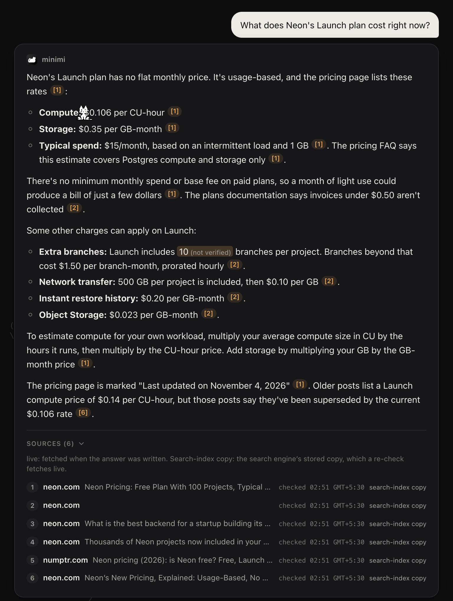
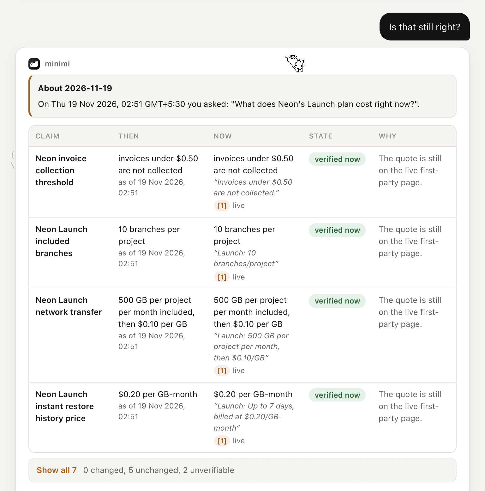
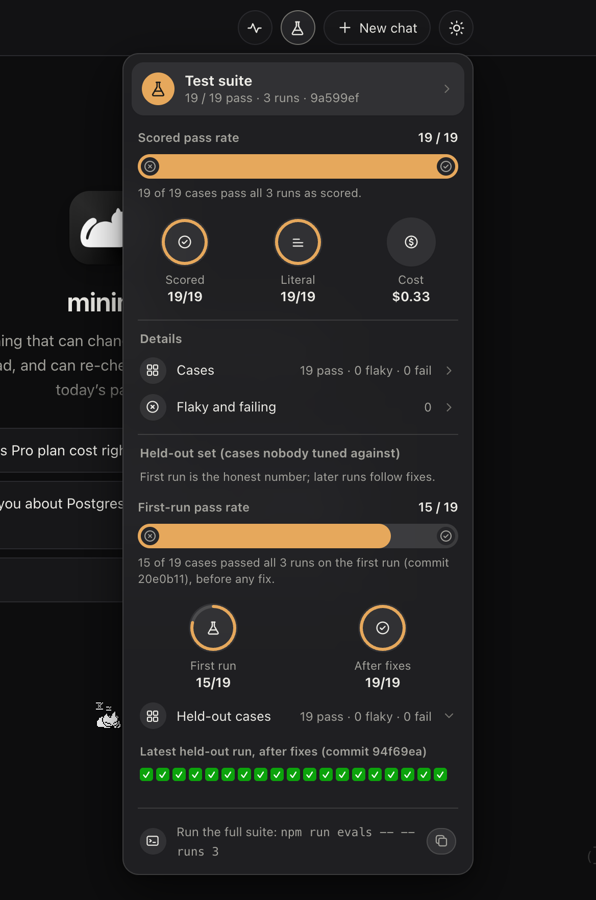
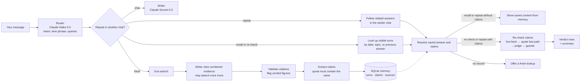

# minimi

**A chat agent with one tool, web search, that remembers what you asked and when, and can re-check what it told you.**

*A personal project built for minimi's agent challenge and named after it. It is not an official minimi product and is not affiliated with the company.*

Ask about a price, plan, or release and minimi searches the web, answers with numbered citations, and extracts dated claims with their source quotes. Days later, ask “Last Tuesday I asked you about Postgres hosting. Has any pricing changed since then?” and it looks up the conversation, fetches the saved sources again, and tells you what it verified, what changed, and what it could not verify.

<p align="center">
  
  
</p>

**[1-minute demo video](docs/demo/minimi-demo.mp4)**: recall of last Tuesday's question, the live re-check, the per-chat numbers, the held-out tests, and the cat.

**[Live demo](https://minimi-production.up.railway.app)** on Railway. Its memory is a SQLite file on a persistent volume, so earlier conversations survive restarts and redeploys. The demo has no accounts: every visitor's questions go into one shared memory, so please don't type anything private.

## Try it

Needs Node 26.13 or later (the current LTS; `.nvmrc` pins 26.13.1), an Anthropic key and an Exa key.

```bash
cp .env.example .env      # fill in ANTHROPIC_API_KEY and EXA_API_KEY
npm install
npm run seed              # three back-dated demo conversations, labelled as seeded history
npm run dev               # http://localhost:3000
```

Then ask the three prompts from the brief:

1. *On Monday we shortlisted 5 CRM tools for a 20-person sales team. Has any of them changed pricing or shipped something big since?*
2. *What did I ask you on 3 November? Is your answer still correct today?*
3. *Last Tuesday I asked you about Postgres hosting. Has any pricing changed since then?*

Or anything current, for example *What does Neon's Launch plan cost right now?*, then *Is that still right?*

To try a repeat, ask *How long will it take to finish GTA 6?* and then *Search for this answer* in that chat. Start a new chat and ask *How long will it take to finish GTA 6?* again. The recall card identifies the earlier question and when the follow-up answered it.

A missing key or an older Node stops startup with one named error (`MissingEnvError` or `UnsupportedNodeError`).

### Deploy with lasting memory

The `Dockerfile` runs minimi on any container host. Memory is one SQLite file at `/app/data/minimi.db`, so mount a persistent volume at `/app/data` and it survives restarts and redeploys. On Railway: create a service from this repo (it builds the `Dockerfile`), add a volume with mount path `/app/data`, and set `ANTHROPIC_API_KEY` and `EXA_API_KEY` as service variables. Keys are never baked into the image (`.dockerignore` excludes `.env`).

## What it does

| You ask | minimi |
| --- | --- |
| A current fact | Searches the web, cites numbered sources, and extracts claims with their quotes, sources, and dates. It marks uncited figures that the question doesn’t supply. Fixed phrases such as `100% completion` skip the “not verified” mark. |
| A stable question | Answers directly on the ordinary chat path. Say “search for this” to request a web search. |
| “What did I ask on 3/11?” | Resolves the date in code using your time zone, states how it read the date, and lists the saved claims *from memory*. |
| “From earlier, what did you say about Postgres hosting?” | Looks up the topic or entities without a date. If matches on different dates score close enough, it asks which conversation you mean. |
| “Is that still right?” | Re-checks saved claims up to the configured limit. It tries the original pages live, takes the exact-quote fast path when it can, and otherwise uses search, a judge model, and code guards. |
| The same question in a new chat | Follows related follow-ups in the earlier chat and re-checks the newest saved claims in that chain. If the chain has no claims, it shows the latest saved answer *from memory*. The card shows when you asked and, if a follow-up was used, when it was answered. |
| Something it has no record of | Offers a fresh lookup and shows the dates it tried and any nearby saved conversations when available. |

<p align="center"></p>

The UI shows the recalled question in a card, a verdict table, a collapsible source list, per-stage timings, and two header menus: **This chat** (citation coverage, live sources, verdicts, latency) and **Test suite** (the main suite's latest run, and the held-out set's first run and run after fixes).

The **Chats** sidebar reopens transcripts saved in this browser. It shows a short title cleaned from the first prompt and the last activity time in your local time zone, such as “Today, 2:14 pm”. The current title also appears above the thread. **Delete** asks for confirmation, then removes the sidebar entry and the browser’s copy of the transcript, and tells the server to forget that chat: its turns are soft-deleted, so recall and re-check skip them.

Use **Edit** on an earlier prompt to replace it in place. On save, the store’s `hideFrom` operation soft-deletes that prompt and every later turn in the same chat. Recall and re-check skip hidden turns. The edited text starts a replacement answer from that point in the thread.

## How it works



- **The model does language; code does what must be exact.** Date resolution, verdict rules, the dates and last-known values printed in answers, and the check time are code, unit-tested. The model writes the words around them.
- **"Unchanged" needs positive evidence fetched live this turn.** A cached page, a timeout or a third-party page cannot produce it; the guards downgrade any verdict that lacks a quote from a live first-party page.
- **One process, two keys, one SQLite file** (`node:sqlite`). The agent core imports no framework; Next.js and the AI SDK sit at the edges.

On a read-only host, the store opens the database in the system temporary directory. Next.js output tracing bundles the SQLite schema and prompt files with the chat and warm-up routes, and the saved eval results with the eval summary route.

Why each choice was made, and what was rejected: [`DESIGN.md`](DESIGN.md). What was verified about the stack: [`docs/DECISIONS.md`](docs/DECISIONS.md).

## Results

Three numbers, each read from a results file in this repo. A case passes when all 3 of its runs pass, on both readings: the scored one and the spec's literal number check (every number the model writes must appear in the evidence, the verdict rows, the stored claims or your message).

| | Cases | Pass at 3 of 3 | What it is | File |
| --- | --- | --- | --- | --- |
| **Held-out set, first run** · *headline* | 101–119 | **15 of 19** | **Confirmatory.** Written after the tuning, never tuned against, run once before any fix. 687 assertions, 13 failed; $0.19. | [`evals/results/heldout-first.json`](evals/results/heldout-first.json), commit `20e0b11` |
| Held-out set, after fixes | 101–119 | 19 of 19 | **Adaptive**, not a held-out result: the same cases after fixing what the first run found ([`evals/heldout/README.md`](evals/heldout/README.md)). 687 assertions, none failed; $0.19. | [`evals/results/heldout.json`](evals/results/heldout.json), commit `94f69ea` |
| Main suite | 1–19 | 19 of 19 | **Tuned regression suite**: the cases the agent was built and tuned against. 663 assertions, none failed; $0.33. | [`evals/results/latest.json`](evals/results/latest.json), commit `9a599ef` |

The product code (`app/`, `src/`) is the same in the two final runs; the commits between them changed only eval checks. Spend is API cost metered by the eval runner under a hard cap. A fresh blind set, written and run once, is the next step before claiming the agent improved.

The table reports the revisions shown. Live evals have not been rerun since the sidebar, edit, recall, repeat, and number-term changes.

The main cases are in [`docs/02-evals.md`](docs/02-evals.md) and the held-out ones in [`evals/heldout/README.md`](evals/heldout/README.md); every change made to the checks, with before and after, is in [`evals/TRIAGE.md`](evals/TRIAGE.md). These are fixture pages and three runs per case: they show the logic holds on these cases, not the model's long-run reliability.

**Latency** (`npm run measure`, 3 passes on one machine, 17 Nov 2026, before the latest changes; [`evals/results/latency.json`](evals/results/latency.json)): router median 1524 ms; claim extraction, which runs after the answer has streamed, median 17773 ms. Per-turn first-text and total times are in the same file.

## Checks

```bash
npm test                    # unit tests, no network
npm run gate                # typecheck, tests, import rules, frozen-contract hash
npm run evals:quick         # 5 cases, one run each: the cheap live check
npm run evals -- --runs 3   # all 19 cases, three runs each; hard spend cap, --budget-usd 4.5 by default
npm run evals:heldout       # the 19 held-out cases, three runs each; writes evals/results/heldout.json
npm run smoke:fresh         # one real question end to end
npm run measure             # fixed turns through the pipeline, writes evals/results/latency.json
```

## Layout

```
app/                 Next.js UI and the chat route (streams pipeline events to the page)
src/core/contracts.ts  the frozen types every module meets at
src/core/pipeline/   router branches: chat, fresh, recall, re-check, no record
src/core/time/       date resolution and formatting (Luxon)
src/core/store/      SQLite memory: turns, claims with supersede chains, sources
src/core/search/     Exa client, first-party and quote checks, citation validation
src/core/llm/        AI SDK adapter and the prompts
evals/               19 scripted cases, fixture pages, harness, results
evals/heldout/       19 held-out cases (101–119), written after the tuning
scripts/             seed, measure, smoke test, gate checks
```

## Known limits

- **Some sites are only served from the search engine's stored copy.** Exa live-crawls most pages when asked (`maxAgeHours: 0`), but for some sites (for example `supabase.com/pricing` on 19 Nov 2026) it returns its stored copy instead. minimi will not call a stored copy "verified now": those claims come back *couldn't verify*, with a note saying whether the stored copy still shows the value.
- **One shared memory on the demo.** There are no accounts, so recall searches every visitor's questions. Deleting a chat in the sidebar forgets it on the server too. If the server ever has no record of a day the browser still has a chat from, the answer card says so and offers to open that chat.
- **Repeat matching uses word overlap.** It can miss paraphrases that use different words. Follow-up chains use stored links and recognizable references such as “search for this answer”.
- The scripted evals run against fixture pages; the live web was checked by hand.

Third-party art and code (the oneko cat, two ASCII animations) are credited in [`CREDITS.md`](CREDITS.md).
